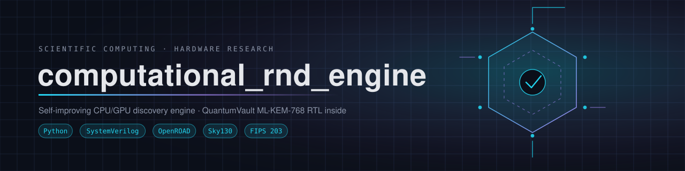
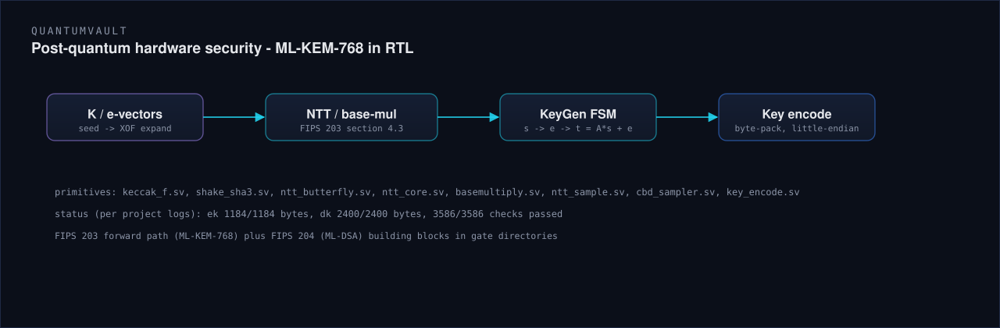
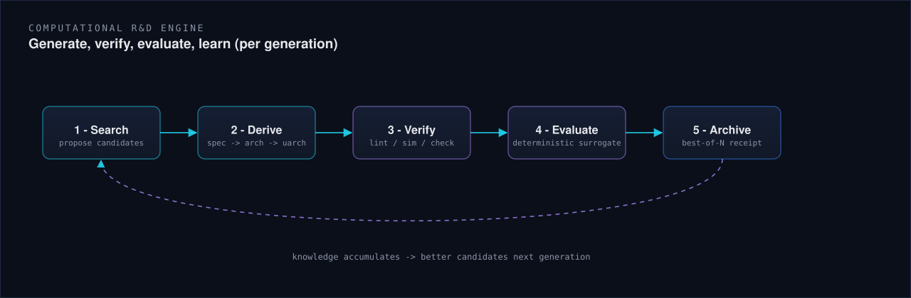

<p align="center">
  
</p>

<p align="center">
  <a href="https://github.com/kushalr5600-commits/computational_rnd_engine/actions/workflows/ci.yml"></a>
  
  
  
</p>

# Computational R&D Invention Engine

A standalone CPU/GPU **invention and design-space exploration engine** centered on the Ic
objective, bundled with **QuantumVault** — a post-quantum cryptography hardware project whose
ML-KEM-768 key generation is implemented and verified in RTL.

## Important (read this first)

The built-in evaluator is a **deterministic surrogate evaluation**. It is intentionally honest
about that boundary. It provides the search/objective infrastructure but is **not a replacement
for cycle-accurate simulation, formal verification, synthesis, FPGA, or silicon measurements.**
See [`docs/PRODUCTION_BOUNDARY.md`](docs/PRODUCTION_BOUNDARY.md).

## QuantumVault — post-quantum hardware security

ML-KEM-768 (FIPS 203) key generation in synthesizable SystemVerilog, verified in simulation.

<p align="center">
  
</p>

- Forward NTT (FIPS 203 Algo 9) with a standard-order FIPS 203 ordering; ZETAS ROM `ZETAS[k] = 17^bitrev7(k) mod 3329`; inverse NTT (Algo 10) with 3303 = 128⁻¹ mod 3329.
- SHAKE-128 XOF matrix expansion, rejection sampling, CBD sampler, base multiplier — all as RTL with testbenches.
- Keygen testbench checks **every byte** of the encapsulated key (ek) and decapsulation key (dk) against fixed-seed golden vectors: **ek 1184/1184 bytes, dk 2400/2400 bytes, 3586/3586 checks** (per project verification logs).
- Encapsulation/decapsulation exist only in the untracked development tree and are intentionally **not** part of this repository.

> Verified means *verified in simulation against fixed seeds*. Nothing here has flown on FPGA or silicon yet.

## How the engine works

<p align="center">
  
</p>

Candidates are produced by the search layer, derived into a specification → architecture →
microarchitecture, checked (lint / simulation / model checking where available), scored by the
deterministic surrogate, and archived with an audit receipt. The knowledge base feeds the next
generation.

## Quick start

```bash
python -m venv .venv
source .venv/bin/activate          # Windows: .venv\Scripts\activate
pip install -e '.[dev]'
pytest
rnd-engine --domain heterogeneous --population 32 --generations 10
```

Results are written to `artifacts/`.

## Repository layout

```
rnd_engine/             the engine package (search, objective, derivation, sign-off, release)
  rtl/templates/        synthesizable SystemVerilog templates for generated cores
tests/                  pytest suite (26 test modules)
configs/                default + Sky130 / GF180 flow configs
eda/                    OpenROAD/Sky130 flow: Dockerfiles, doctor, install & check scripts
docs/                   architecture, production boundary, reproducibility, sign-off status
quantumvault/           QuantumVault RTL — gate_9c_vector_arithmetic, gate_9d_keygen (tracked)
.github/workflows/      CI: compileall, ruff, pytest (3.11/3.12), honest EDA doctor report
```

## Verification & honesty

- CI runs `python -m compileall`, `ruff check`, and `pytest` on Python 3.11 and 3.12.
- CI never reports PASS for a stage that did not execute — EDA gates report
  `BLOCKED_EXTERNAL_DEPENDENCY` when the EDA toolchain is outside the runner.
- See [`docs/VALIDATION_MATRIX.md`](docs/VALIDATION_MATRIX.md) and
  [`docs/REPRODUCIBILITY.md`](docs/REPRODUCIBILITY.md) for exactly what has been checked, where, and how.

## Known limitations

- Surrogate evaluation is not physics. Generated designs are unsynthesized until proven otherwise.
- The RTL keygen path is verified in simulation only.
- The EDA flow is verified on a development host; laptop results differ by environment — run `rnd-engine eda-doctor` locally for an honest report.
- Working tree of the upstream development copy contains additional gates and scratch artifacts; only reviewed sources are tracked in this repository.

## License

MIT — see [LICENSE](LICENSE).

<p align="center">
  <sub>Built solo by <a href="https://github.com/kushalr5600-commits">Kushal</a> · Hardware that proves things · <a href="https://github.com/kushalr5600-commits/blackbox">BLACKBOX</a> · <a href="https://github.com/kushalr5600-commits/nexus-os">nexus-os</a></sub>
</p>
